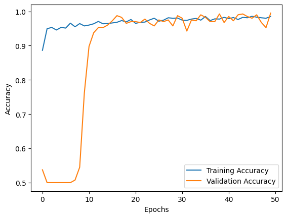
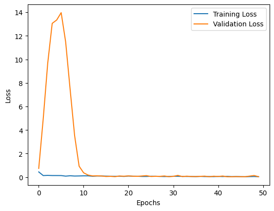
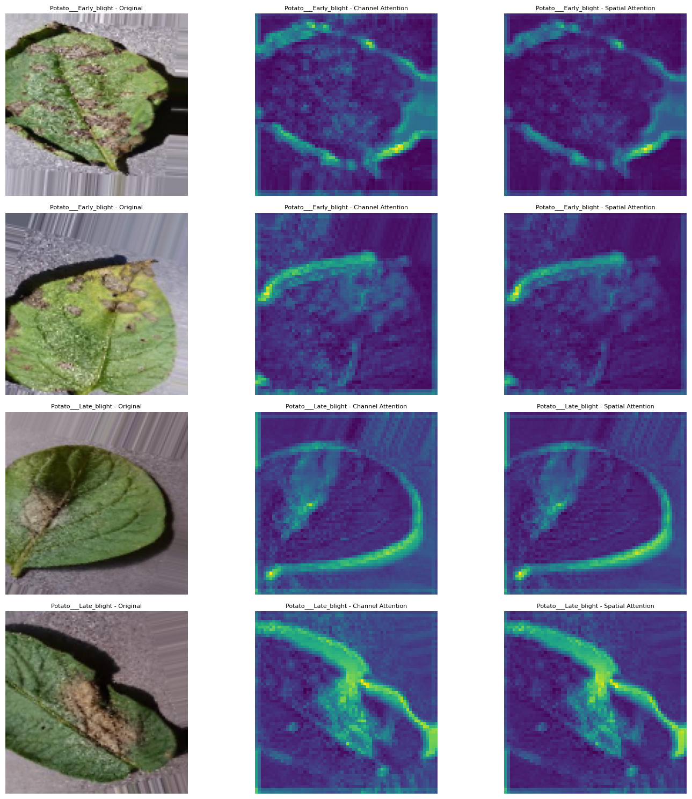

# Potato and Tomato Blight Classification with an Attention CNN

Code accompanying **An Attention Based Deep Learning Approach for Classification of Potato and Tomato Blight Leaves**.

**Authors:** **Naimul Islam Udoy**, **Arka Chakraborty**, Aung Koko, and Aditta Chowdhury.

The paper studies early-versus-late blight classification using a CNN with channel and spatial attention branches and additive fusion, described in the paper as Tri-Attention.

**Current code coverage:** the potato notebook is included. The tomato experiment, dataset files, and trained model file have not been supplied. This is an organized implementation snapshot, not a verified full reproduction of every paper result.

## Experiments

| Experiment | Classes | Available implementation |
| --- | --- | --- |
| Potato | Early blight, late blight | [Potato attention CNN notebook](notebooks/potato_attention_cnn.ipynb) |
| Tomato | Early blight, late blight | Reported in the paper; code not yet included |

The supplied potato model does not classify healthy leaves. The paper mentions healthy potato images in its dataset overview, but this notebook explicitly selects only the two blight classes.

## Model overview

The implementation accepts RGB images resized to 128 × 128 and applies:

1. A 32-filter convolution, batch normalization, and max pooling.
2. A 64-filter convolution and batch normalization.
3. Parallel channel and spatial refinement, combined by element-wise addition.
4. Max pooling, flattening, a 128-unit dense layer, and dropout of 0.5.
5. A two-unit softmax output.

The channel branch uses global average pooling and two dense layers. The spatial branch averages feature channels, applies a 3 × 3 sigmoid convolution, and reweights the input features. “Combined attention” refers to the additive fusion of these branches; no third independent attention branch is implemented.

The training cell specifies Adam with learning rate 0.0001, categorical cross-entropy, batch size 32, and 50 epochs. Data augmentation includes rotation, shifts, zoom, and horizontal flips, with rescaling by 1/255.

## Repository contents

| Path | Purpose |
| --- | --- |
| `notebooks/potato_attention_cnn.ipynb` | Original code cells with explanatory sections and cleared outputs |
| `figures/notebook_exports/` | Selected historical training plots and refined-feature visualization |
| `results/PAPER_REPORTED_RESULTS.md` | Values transcribed from the supplied paper, explicitly distinguished from reruns |
| `results/historical_outputs/` | Saved text outputs from selected original cells |
| `docs/RUNNING.md` | Colab/local setup and execution dependencies |
| `docs/CODE_REVIEW.md` | Evaluation, checkpoint, and paper-to-code limitations |
| `docs/GITHUB_UPLOAD.md` | Instructions to create or update this paper's repository |
| `docs/SOURCE_INVENTORY.json` | Source hashes and figure provenance |
| `data/README.md` | Class folders and split documentation |
| `requirements.txt` | Dependencies inferred from the code |
| `.gitignore` | Dataset, model, environment, and cache exclusions |

## Setup

The original notebook uses Google Colab and absolute Google Drive paths. Follow [the running guide](docs/RUNNING.md) before execution. For a local virtual environment:

```bash
python -m venv .venv
```

Activate it in Windows PowerShell:

```powershell
.venv\Scripts\Activate.ps1
```

Or in macOS/Linux:

```bash
source .venv/bin/activate
```

Then install dependencies and open Jupyter:

```bash
python -m pip install -r requirements.txt
python -m jupyter lab
```

Skip the Drive-mount cell locally and update the absolute paths. Dependencies are unpinned because the original tested package versions were not supplied. We have not tested installation, model loading, or end-to-end training for this organization update.

## Dataset

The notebook expects a PlantVillage directory with these exact subfolders:

- `Potato___Early_blight`
- `Potato___Late_blight`

See [data/README.md](data/README.md). The notebook's saved output records 1,600 training images and 400 validation images. These are historical recorded counts, not a new dataset audit.

The exact dataset download URL, export/version, and split manifests were not provided. Add those details before claiming exact reproducibility. Follow the dataset source's access, license, and citation terms.

## Results

The following values are **reported in the supplied manuscript**, not newly reproduced:

| Crop | Training accuracy (%) | Validation accuracy (%) |
| --- | ---: | ---: |
| Potato | 99.47 | 99.25 |
| Tomato | 95.75 | 93.98 |

Source: manuscript Table II. Additional manuscript values are listed in [paper-reported results](results/PAPER_REPORTED_RESULTS.md).

The saved notebook contains results from multiple stages that cannot presently be linked to the same weights and image sets. Its training cell prints validation accuracy 0.9925, while later external-model evaluation cells show rounded accuracies of 0.55 and 0.66 on different subsets. These are separate historical outputs, not interchangeable estimates. The model file and evaluation provenance are needed to explain the difference.

## Historical visual examples

The following PNGs were extracted directly from existing notebook outputs. They were not regenerated, and their exact relationship to the published figures/checkpoint has not been verified.

### Training and validation accuracy



### Training and validation loss



### Attention-refined features



The visualization averages normalized outputs of the two `Multiply` layers. These are refined feature tensors, not direct attention-weight maps or a validated lesion-localization method.

## Reproducibility notes

- The supplied notebook covers potato only; no tomato implementation is implied by the paper-level repository title.
- Validation receives random augmentation because both generators share the same augmentation configuration.
- The final 300-image subset is selected from the same class directories, without an independent split manifest or exclusion check.
- `model_path` is undefined in one evaluation cell. Other cells require an external `.keras` model that was not uploaded.
- Early-stopping and learning-rate callback objects are created but are not passed into `model.fit`.
 The original 300 individual prediction plots were omitted from the repository notebook to keep it small; selected figures and text outputs remain traceable.

## Paper and citation

**An Attention Based Deep Learning Approach for Classification of Potato and Tomato Blight Leaves**  
Naimul Islam Udoy, Arka Chakraborty, Aung Koko, and Aditta Chowdhury.

The supplied paper carries the heading of the **2025 28th International Conference on Computer and Information Technology (ICCIT)**. 
URL: https://ieeexplore.ieee.org/abstract/document/11491611
DOI: https://doi.org/10.1109/ICCIT68739.2025.11491611
If you find this work helpful, consider citing our study:
@INPROCEEDINGS{11491611,
  author={Udoy, Naimul Islam and Chakraborty, Arka and Koko, Aung and Chowdhury, Aditta},
  booktitle={2025 28th International Conference on Computer and Information Technology (ICCIT)}, 
  title={An Attention Based Deep Learning Approach for Classification of Potato and Tomato Blight Leaves}, 
  year={2025},
  volume={},
  number={},
  pages={4538-4542},
  keywords={Feeds;Protocols;Location awareness;HTTP;Mobile communication;LoRa;Pixel;Data communication;Attention mechanisms;Convolutional neural networks;Batch normalization;Convolutional Neural Network(CNN);Deep learning;Tri-CNN},
  doi={10.1109/ICCIT68739.2025.11491611}}


